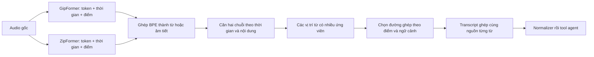

# Kế hoạch ghép GipFormer + ZipFormer theo timestamp ở mức từ

## Mục tiêu

Tạo một transcript từ các từ/âm tiết của hai ASR trên cùng audio. Trong một câu, từ thứ nhất có thể lấy từ GipFormer, từ tiếp theo lấy từ ZipFormer. Timestamp dùng để căn đúng vị trí, còn quyết định chọn từ cần điểm tin cậy và ngữ cảnh.

Không cần chia audio thành hàng loạt đoạn 100–200 ms rồi nhận dạng riêng: các đoạn quá ngắn dễ mất ngữ cảnh. Hai ASR vẫn nhận dạng audio có đủ ngữ cảnh, sau đó mới căn và chọn từng đơn vị nhỏ trên đầu ra.

Lượt đang chạy ở `outputs/dual_asr_qwen/` là baseline Qwen đọc hai transcript. Phương án trong tài liệu này là một nhánh thử nghiệm khác, cần so sánh với baseline đó.

## Đã kiểm tra trực tiếp trên máy

Đã chạy thử CPU trên `train_0083` với đúng hai ONNX và sherpa-onnx 1.12.40+cuda12.cudnn9:

| Dữ liệu trả về | GipFormer | ZipFormer |
|---|---:|---:|
| BPE token | 29 | 28 |
| Timestamp token | 29 | 28 |
| Log-probability token (`ys_log_probs`) | 29 | 28 |
| Duration token / word đã ghép | Chưa có | Chưa có |

Timestamp quan sát ở mẫu này nằm trên lưới khoảng 40 ms. Hai model có thể lệch 40–80 ms ở cùng từ. Đây là mốc token trong quá trình giải mã, không phải ranh giới âm thanh đã được căn chính xác bằng forced alignment.

Kết quả thô đã lưu:

- [GipFormer probe](outputs/timestamp_fusion_plan/gipformer_probe.json)
- [ZipFormer probe](outputs/timestamp_fusion_plan/zipformer_probe.json)

Code hiện tại chỉ trả `stream.result.text`; cache cũ không có token/timestamp/log-probability. Vì vậy cần chạy lại **riêng hai ASR một lượt** để bổ sung các trường này cho 5.036 audio. Việc căn/chọn từ sau đó chỉ đọc cache, không cần nhận dạng lại hay chạy Qwen/tool calling để thử mỗi bộ tham số.

## Luồng đề xuất

### 1. Lấy và lưu dữ liệu theo thời gian

- Bổ sung `transcribe_detailed(audio)`; giữ `transcribe(audio) -> str` để luồng cũ tiếp tục sử dụng được.
- Lưu text gốc, BPE token, timestamp, log-probability, sample rate, thời lượng và cấu hình decoder. Giữ nguyên greedy search ở bản đầu để tách ảnh hưởng của fusion khỏi thay đổi thuật toán nhận dạng.
- Ghép token theo dấu bắt đầu từ của từng tokenizer. Ví dụ ` DỊ` + `U` thành `DỊU`; không coi BPE của hai model là cùng một đơn vị hay cùng một ID.
- Với tiếng Việt, một đơn vị có khoảng trắng thường là âm tiết; giữ cả tầng âm tiết và tầng cụm nhiều âm tiết để xử lý tên/số.
- `start` lấy từ token đầu; thời điểm kết thúc chỉ ước lượng từ mốc tiếp theo/giới hạn audio và phải ghi `end_is_estimated=true`. Không giả định quãng im lặng là thời lượng của một từ.
- Cache riêng theo audio SHA256, model fingerprint, decoder config, phiên bản runtime và schema. Ghi nguyên tử, có manifest, tiến độ và resume từng audio; không ghi đè cache text cũ.

Đầu ra: `outputs/asr_timed_v1/<model>/<audio-key>.json` cho cả lượt cuối và history.

### 2. Căn hai chuỗi từ

- Dùng thứ tự từ và các đoạn hai ASR đồng ý làm mốc, kết hợp khoảng cách thời gian trong dynamic programming.
- Bắt đầu thử cửa sổ lệch khoảng ±200 ms; đo lại trên tập phát triển rồi chốt ngưỡng. Không coi 200 ms là độ chính xác thực tế của timestamp.
- Cho phép 1–1, 1–n, n–1 và từ rỗng: một ASR có thể bỏ từ, nối chữ hoặc tách nhiều token. Ví dụ `siro ho` / `SIROHO`, `Hansen` / `Han Sen`.
- Chuẩn hóa cách viết tương đương chỉ ở bản dùng để căn: hoa/thường, dấu câu, 45/bốn lăm trong ngữ cảnh phù hợp. Giữ nguyên bản gốc để xuất và truy nguồn; không xóa các khác biệt quan trọng như 30/50, Minh/mình, đã/chưa.
- Cửa sổ có một model bỏ nhiều từ phải được căn lại bằng các mốc bên ngoài, thay vì ghép từ theo số thứ tự.

Đầu ra: mạng ứng viên theo vị trí từ, gồm ứng viên hai model và trường hợp thêm/bỏ từ. Đây là cách tổ chức gần với word transition network của [ROVER, NIST](https://www.nist.gov/publications/post-processing-system-yield-reduced-word-error-rates-recognizer-output-voting-error).

### 3. Chọn từng từ, có ràng buộc với cụm quan trọng

Hai model bất đồng thì chỉ có một phiếu mỗi bên; bỏ phiếu đa số không giải quyết được. Timestamp cũng không cho biết từ nào đúng.

Điểm chọn dự kiến kết hợp:

- Độ tin cậy token/từ **đã hiệu chỉnh riêng cho từng model**.
- Mức khớp thời gian và sự đồng ý giữa các model.
- Tính phù hợp của từ trong ngữ cảnh lân cận.
- Mức phạt bỏ từ, lặp từ hoặc chuyển nguồn quá nhiều. Phạt chuyển nguồn là trọng số mềm, vẫn cho phép đổi model ở từng vị trí.
- Trọng số theo loại thông tin chỉ được chọn trên tập phát triển; không áp luật cứng “mọi số lấy Gip, mọi thiết bị lấy Zip”.

**Không chọn bằng cách so trực tiếp raw probability.** Ở mẫu đã probe, Gip cho từ sai `PHONG` khoảng 0,771, Zip cho `PHÒNG` đúng khoảng 0,433 khi lấy exp(log-probability). Các giá trị đó là điểm token trong decoder, không phải xác suất từ đúng. Cũng không cộng điểm thô theo số BPE vì tokenizer khác nhau sẽ tạo thiên lệch độ dài.

Làm hai biến thể để biết thành phần nào có ích:

1. **Bản A:** điểm đã hiệu chỉnh + ràng buộc căn thời gian, chọn đường tốt nhất qua mạng ứng viên.
2. **Bản B:** chỉ những vùng bất đồng khó mới dùng Qwen chọn giữa các ứng viên tại vùng đó, với một ít ngữ cảnh trước/sau. Qwen trả ID ứng viên/đường hợp lệ; không được viết lại cả câu hoặc tự thêm từ ngoài mạng ứng viên. Kiểm tra output bằng code và giữ phương án fallback nếu không chọn được.

Nếu hai phương án như 30/50 đều hợp ngữ cảnh và điểm không đủ phân biệt, giữ cờ không chắc chắn cùng hai ứng viên. Qwen chỉ đọc text không có thêm bằng chứng âm học để biết chắc số đã được nói. Nếu pilot cho thấy đây là nút thắt, bước nâng cấp là chấm lại cùng các ứng viên trên cùng audio bằng các checkpoint RNN-T hiện có; việc tính likelihood cho transcript tùy ý cần triển khai riêng, không có sẵn chỉ từ `ys_log_probs` của đường greedy. Chưa đưa phần này thành điều kiện bắt buộc của MVP.

Từ thường vẫn được chọn riêng. Nhưng phải ràng buộc các chuỗi có quan hệ chặt:

- Số tiền, nhiệt độ, phần trăm, giờ, chuỗi điện thoại và mã chuyến.
- Tên thuốc, tên người/địa điểm nhiều thành phần.
- Các cụm phủ định/trạng thái như `chưa uống`, `đừng bật`, `đã trả`.

Ví dụ `một trăm hai mươi ba triệu` và `một trăm hai triệu` là hai đường ứng viên cho cùng một giá trị. Không lấy các mảnh tùy ý để tạo ra một số thứ ba không có bằng chứng. Đây là ràng buộc trong vùng vài từ, không phải chọn nguyên câu.

Nếu cả hai đều nhận sai tên thuốc, fusion không có bảo đảm sửa được. Lưu nguyên vùng bất đồng để rà/gen data, không dùng danh sách đáp án của sample để điền tên vào inference.

### 4. Đánh giá trước khi nối vào calling

Chốt tập phát triển và tập kiểm tra theo hội thoại trước khi chỉnh điểm/ngưỡng; gom thêm các mẫu gần trùng theo template khi có thể để giảm rò rỉ. Các phân tích toàn train đã làm là dữ liệu khám phá, không dùng lại toàn bộ để vừa chỉnh vừa tuyên bố kết quả độc lập.

Quy trình:

1. Pilot khoảng 100 audio gồm tên thuốc, số, mã, phủ định, tên người, thiết bị và history. Dùng các ca đã rà để kiểm tra cơ chế; thêm mẫu chọn ngẫu nhiên để tránh chỉ tối ưu các lỗi đã biết.
2. Kiểm tra: text tái dựng đúng decoder, timestamp tăng hợp lệ, không rơi cuối câu, không lặp từ, không tự chế chữ số/tên và không lệch sau đoạn thiếu từ.
3. Chỉnh bộ chọn trên tập phát triển rồi đóng băng cấu hình.
4. Trích cache timestamp cho đủ 5.036 audio; thử fusion offline bằng cache.
5. Đo nội dung ASR trước Qwen trên tập kiểm tra. Khi đạt, mới chạy full 1.545 mẫu qua normalizer và agent.

Chỉ số ưu tiên theo yêu cầu hiện tại:

- Giữ đúng tên/định danh thuốc, người nhận, địa chỉ, mã.
- Giữ đúng giá trị số, chữ số điện thoại, ngày/giờ, quan hệ trước/sau/kém.
- Giữ đúng hành động, phủ định và trạng thái đã/chưa.
- Số trường được sửa và số trường bị làm sai mới so với từng ASR; thống kê riêng từng domain, cả câu cuối và history.
- Mức thông tin đúng có thể biểu diễn trong mạng ứng viên: chỉ dùng reference **offline** để đo tiềm năng tối đa, không dùng làm bộ chọn khi inference.
- Khi chạy downstream: ghi riêng lỗi tại ASR ghép, lỗi normalizer đổi thông tin và lỗi agent chọn tool/argument. Giữ các cấu hình downstream giống nhau giữa các nhánh so sánh.

WER có thể giữ làm phụ lục nếu cần, không dùng làm mục tiêu quyết định chính. Đặc biệt, khác cách viết số hoặc phiên âm còn khôi phục được không tự động bị coi là mất thông tin.

### 5. Log bắt buộc cho từng lựa chọn

Mỗi vị trí/vùng ghép cần lưu:

`audio_id, start, end_estimated, gip_words, zip_words, source_token_indices, raw_scores, calibrated_scores, chosen_words, chosen_source, decision_reason, uncertain, candidate_paths, config_hash`.

Xuất thêm CSV dễ rà và audio path để người kiểm tra mở đúng đoạn. Lưu transcript ghép trước normalization, normalized text sau Qwen, tool calls và observation riêng. Có thể thay thuật toán chọn từ và chạy lại từ cache, không cần nhận dạng lại audio.

## Thứ tự triển khai và phạm vi

| Mốc | Kết quả cụ thể |
|---|---|
| M1 | API detailed + cache timestamp + ghép BPE; tái dựng đúng text cũ |
| M2 | Căn thời gian/nội dung + CSV các vị trí từ và vùng bất đồng trên pilot |
| M3 | Bộ chọn A/B + ràng buộc số/tên/phủ định + báo cáo trường thông tin trên holdout |
| M4 | Cache full, benchmark full và so với Gip, Zip, Qwen đọc hai transcript |

Cấu hình dự kiến: `ASR_MODE=dual`, thêm `ASR_COMBINE=timestamp_word`, và `FUSION_SELECTOR=calibrated|local_qwen`. Tách module căn/chọn từ khỏi normalizer/tool agent; giữ hai checkpoint và Qwen hiện có, chưa cần thêm model căn âm riêng trong MVP.

**Cập nhật triển khai 03/11/2026:** đã thực hiện cache token/timestamp/log-probability đủ 5.036 audio × 2 ASR; triển khai ghép từ có hiệu chỉnh điểm và ngữ cảnh n-gram từ phần fit, tích hợp `ASR_COMBINE=timestamp_word` cho câu cuối và history. Bộ chọn được chốt bằng validation và kiểm tra riêng trên 829 audio; báo cáo ở `outputs/timestamp_word_fusion/comparison/BAO_CAO_GHEP_TU.md`. Lượt này đánh giá nội dung ASR, chưa chạy lại downstream calling cho nhánh timestamp. Bộ chọn Qwen cục bộ/RNN-T chấm lại ứng viên vẫn là các bước nâng cấp, chưa triển khai.

## Nguồn kỹ thuật

- [sherpa-onnx: cấu trúc kết quả offline](https://github.com/k2-fsa/sherpa-onnx/blob/master/sherpa-onnx/csrc/offline-stream.h).
- [sherpa-onnx: binding Python các trường kết quả](https://github.com/k2-fsa/sherpa-onnx/blob/master/sherpa-onnx/python/csrc/offline-stream.cc).
- [NIST: ROVER, căn output ASR và chọn đường qua word transition network](https://www.nist.gov/publications/post-processing-system-yield-reduced-word-error-rates-recognizer-output-voting-error).

Tính khả dụng các trường ở hai checkpoint được xác minh bằng probe local, không suy từ việc API có khai báo trường.
